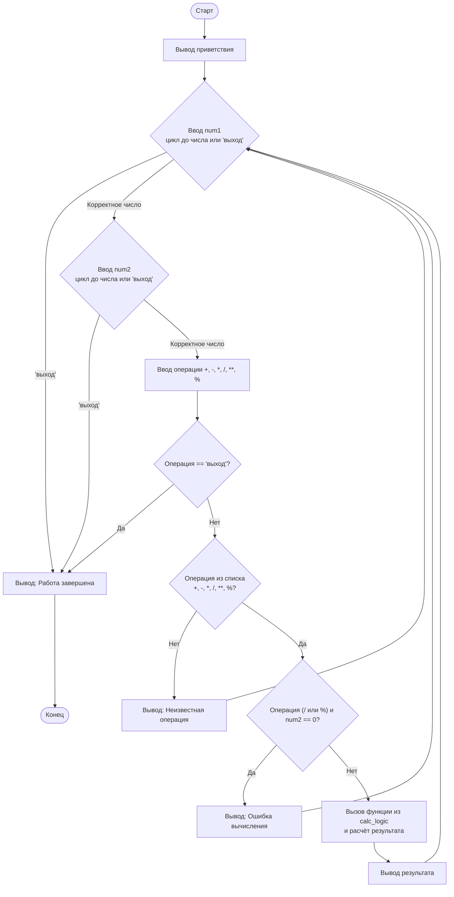

# Калькулятор
Консольная программа-калькулятор на Python 3.
## Возможности
- Сложение, вычитание, умножение, деление
- Обработка ошибок ввода
- Обработка деления на ноль
## Требования
- Python 3.10+
- ОС РЕДОС (или другой Linux)
## Установка и запуск
1. Клонируйте репозиторий (или скопируйте папку)
2. Создайте виртуальное окружение:
python3 -m venv venv
3. Активируйте окружение:
source venv/bin/activate
4. Запустите программу:
python main.py
## Автор
Надеин Евгений, группа ПРЗ-23, 2026
## Алгоритм работы

Ниже представлена блок-схема основной логики калькулятора:

